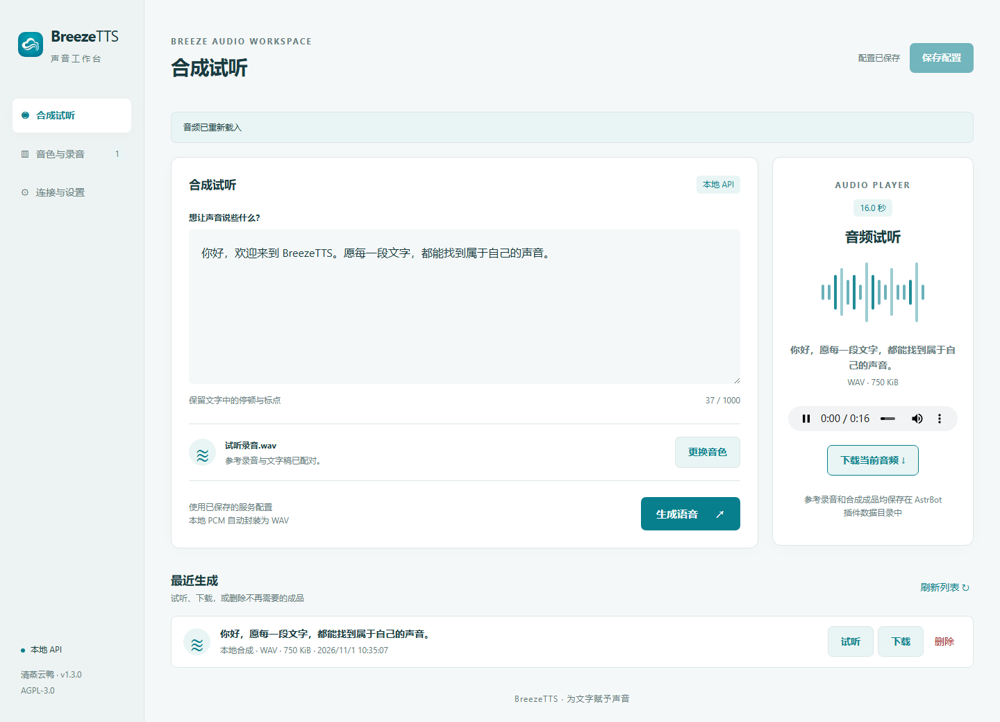
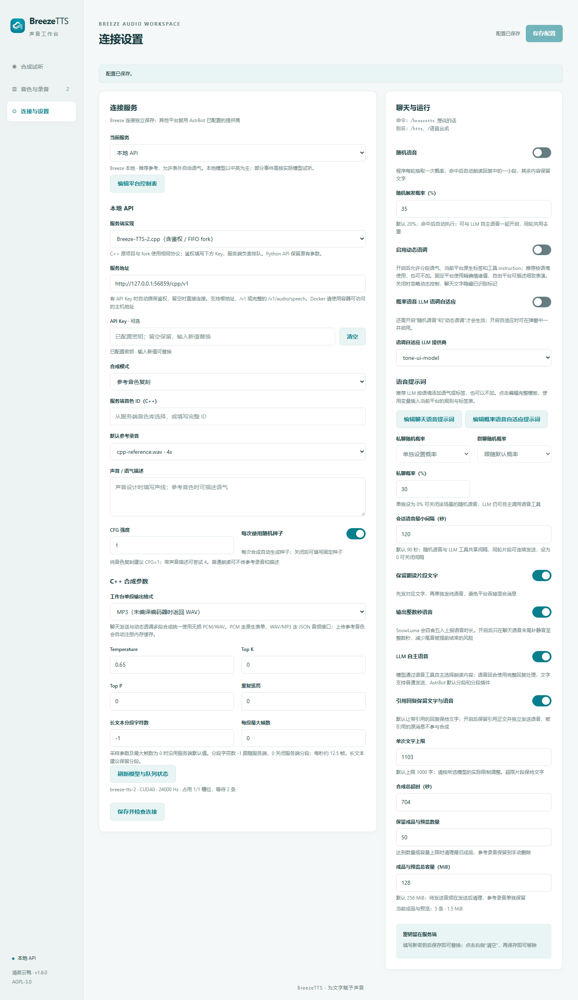
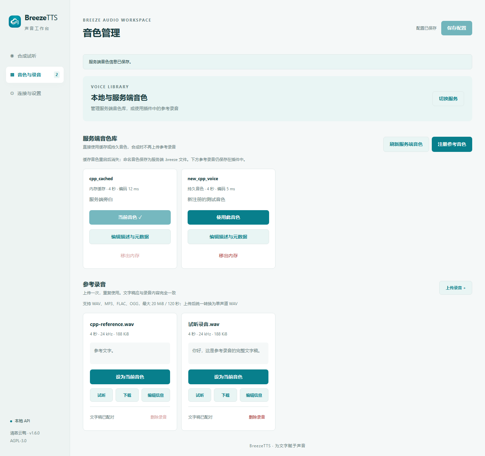
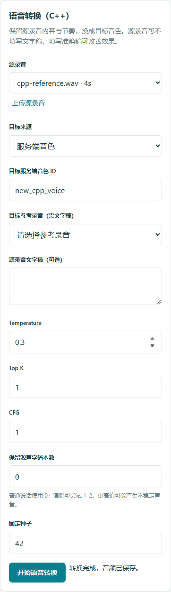
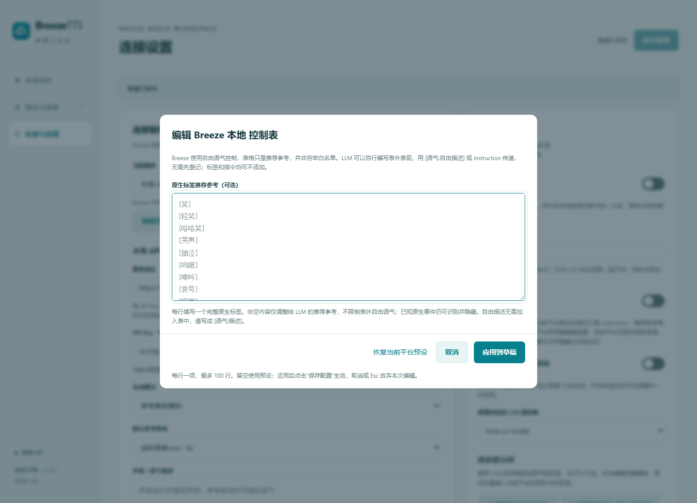
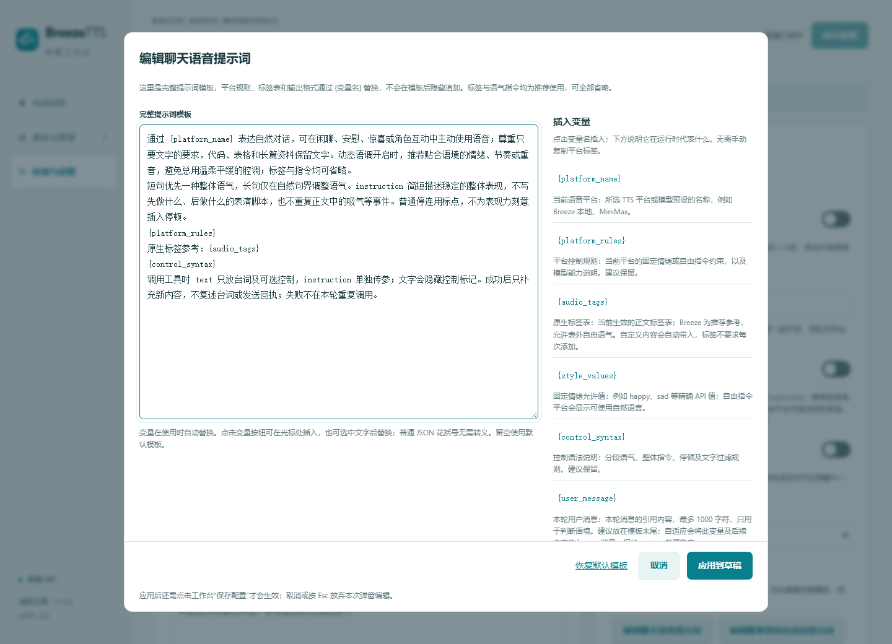

# BreezeTTS for AstrBot

为 AstrBot 提供 BreezeBlue 官方与本地语音合成，并复用支持动态语调的 AstrBot TTS 提供商，配备音色管理和音频试听工作台

作者：清蒸云鸭

许可证：[AGPL-3.0](LICENSE)



## 插件功能

- **本地语音合成**：参考音色复刻、文字声音设计、普通朗读，支持 CFG、随机种子和语气指令
- **C++ HTTP 服务端**：兼容 HoppouAI 原项目及 WhiteCloudOL 鉴权/FIFO fork，支持服务端音色库、模型/队列状态、扩展采样参数、多种音频格式和语音转换
- **官方语音合成**：选择账号或公共音色，调整模型、语言、语速、音量和表演指令
- **官方音色创建**：上传录音克隆声音，或通过文字设计音色；生成预览、试听，再保存到账号
- **音频管理**：上传参考录音、编辑文字稿、选择当前音色，试听、下载和删除音频
- **聊天语音**：通过聊天命令、LLM 语音工具或自动回复发送语音消息
- **PC 与手机工作台**：自适应布局、明暗主题、胶囊开关和播放器状态提示

## 安装与打开

使用 AstrBot 4.26.0 或更新版本，在插件管理中通过仓库地址安装：

```text
https://github.com/WhiteCloudOL/astrbot_plugin_breezetts
```

安装后打开 **插件 → BreezeTTS → BreezeTTS 工作台**。工作台包含“合成试听”“音色与录音”“连接与设置”三个入口

更新插件后，在插件管理中重载 BreezeTTS，再刷新工作台，使页面与运行中的插件同步

## 配置本地 API

1. 在“连接与设置”选择 **本地 API**
2. 填写服务地址，例如 `http://127.0.0.1:7860` 或 `http://127.0.0.1:7861`
3. 按服务设置填写 API Key：有值时自动携带 Bearer 鉴权，留空时使用直接连接
4. 点击 **保存并检查连接**，确认连接成功
5. 选择合成模式并配置声音

| 合成模式 | 配置方法 |
| --- | --- |
| 参考音色复刻 | 在“音色与录音”上传录音、填写完整准确的文字稿，再点击“设为当前音色” |
| 声音设计 | 在连接设置中填写声音描述，例如“声音清晰、语气温柔的年轻女性” |
| 普通朗读 | 选择模式后即可输入文字合成 |

CFG 建议从 `1` 开始，使用声音或语气描述时可尝试 `4`。本地合成默认每次使用随机种子；关闭“每次使用随机种子”后，可填写固定种子复现声音效果

服务地址支持根地址、`/v1` 或完整 `/v1/audio/speech` 路径。容器部署时，填写容器能够访问的主机地址。本地返回的 PCM 会自动封装为可播放和下载的 WAV

### 管理参考音色

本地模式的音色页集中管理参考录音和文字稿：

1. 点击 **上传录音**，选择 WAV、MP3、FLAC 或 OGG 文件
2. 在弹出的编辑框中填写录音名称及完整文字稿
3. 点击 **设为当前音色**，完成选择
4. 使用卡片上的 **试听、下载、编辑信息** 管理录音

上传上限为 20 MiB、时长 0.1–120 秒，最多双声道；录音会统一转换为单声道 WAV

## Breeze-TTS-2.cpp 本地服务

在“连接与设置 → 本地 API → 服务端实现”选择 **Breeze-TTS-2.cpp（含鉴权 / FIFO fork）**。原 Python API 继续保留；已有配置默认保持 Python 实现，切换时需要明确选择 C++ 并保存。

| 项目 | 接入特点 | BaseURL 示例 |
| --- | --- | --- |
| [HoppouAI/Breeze-TTS-2.cpp](https://github.com/HoppouAI/Breeze-TTS-2.cpp) | GGUF 推理、服务端音色库、原生表单与 PCM 流 | `http://127.0.0.1:8080/v1` |
| [WhiteCloudOL/Breeze-TTS-2.cpp](https://github.com/WhiteCloudOL/Breeze-TTS-2.cpp) | Bearer 鉴权、FIFO 排队，相同合成与音色接口 | `http://127.0.0.1:7863/v1` |

- **音色库**：打开“音色与录音 → 服务端音色库”，查询、注册并直接使用服务端 ID。留空名称创建内存缓存；填写英文、数字、短横线或下划线名称会持久保存，同名会覆盖。可编辑描述和 JSON 元数据；“移出内存”保留持久音色文件，重启后会重新加载，不等于永久删除。
- **合成参数**：支持 Temperature、Top K、Top P、重复惩罚、长文本分段与最大帧数。采样参数/最大帧数为 0 时跟随服务端默认值；分段字符数 -1 跟随服务端，0 关闭分段。单段工作台输出支持 PCM、WAV、MP3，服务端缺少 MP3 编码器时接受实际返回的 WAV。聊天和多段动态语调统一使用无损 PCM/WAV。
- **状态与排队**：设置页可刷新模型、设备、采样率和队列占用。旧版原项目缺少队列接口时显示“未提供”，不会误判鉴权失败。请求等待 FIFO 和合成完成，超时需覆盖排队及合成；服务端返回忙碌或错误时不自动重发。
- **语音转换**：在“合成试听 → 语音转换（C++）”上传或选择源录音，目标可用服务端音色 ID 或配有准确文字稿的参考录音。源文字稿可选；支持转换专用采样参数与声学码本数，生成结果进入“最近生成”。普通说话保持声学码本数为 0，演唱可尝试 1–2。
- **取消任务**：合成、参考音色注册和转换支持取消，关闭本次请求连接；fork 会移除已断开的排队请求。正在生成的任务何时停止由服务端决定。鉴权密钥仅存服务端，不返回页面或写入请求日志。

原“本地参考音色”区域继续保留；选择 C++ 后同一“音色与录音”入口显示“本地与服务端音色”，上方增加服务端音色库。原“合成试听”和“连接与设置”入口不变。本次接入 HTTP 功能，未增加 WebSocket 实时会话。





## 配置 BreezeBlue 官方 API

1. 在“连接与设置”选择 **BreezeBlue 官方 API**
2. 服务地址填写 `https://api.breeze.blue/v1`，输入官方开发者 API Key
3. 点击 **保存并检查连接**，获取可用模型列表
4. 打开“音色与录音”，查询个人或公共音色，点击 **使用此音色**；也可在设置中填写已有的音色 ID
5. 按需选择模型、语言、输出格式及声音参数

| 参数 | 说明 |
| --- | --- |
| 模型 ID | 留空由官方自动选择，也可从模型列表选择 |
| 语言代码 | 留空自动识别，或填写 `zh`、`en`、`ja` 等代码 |
| 表演指令 | 描述朗读情绪、语气与节奏 |
| 语速 / 音量 | 调整语速倍率和音量倍率 |
| 交付方式 | 同步、流式接收、后台任务；音频完整接收后进入播放器 |
| 输出格式 | WAV、MP3、FLAC、PCM、AAC、Opus 及官方采样率 / 码率变体；PCM 自动封装为 WAV |

已有官方音色时，可直接在“连接与设置 → BreezeBlue 官方 API → 音色 ID”中粘贴完整 `voice_id` 并保存，无需先同步目录。插件不要求固定 ID 前缀，会清理复制内容首尾的空格、换行、BOM 和零宽空格，不改写 ID 本身。不要粘贴音色名称、预览 ID、整个网址或额外引号；API Key 须有权访问该音色。缺少密钥、缺少音色和上游 401/403/404 会分别提示；“保存并检查连接”检查服务和模型列表，不等于音色合成权限验收。

### 创建官方音色

官方模式的音色页集中展示账号目录和音色创建表单：

- **参考录音克隆**：选择已有录音或点击“上传克隆录音”，填写名称和语言；录音至少 3 秒，转换后最大 5 MB
- **文字设计音色**：填写音色名称、语言、声音描述及试听文字

点击 **生成音色预览** 后先试听，再点击 **保存到官方账号**。保存成功后即设为当前官方音色。需要验证的音色会显示预览 ID，可前往官方控制台完成验证

## 合成、试听与下载

在“合成试听”输入文字，点击 **生成语音**。完成后右侧播放器显示当前音频及播放时长；手机视图中播放器位于输入区下方

“最近生成”列出已保存的成品和预览，支持试听、下载和删除。重新打开工作台时会载入最近一条成品，点击播放器即可播放。切换音色时，点击输入区中的 **更换音色**

## 聊天中使用

```text
/breezetts 你好，欢迎使用 BreezeTTS
/btts Hello world
/语音合成 今天也要开心
```

在“聊天与运行”中可通过胶囊开关调整：

- **随机语音**：程序每轮按配置的概率抽取一次，命中后自动将回复中的一小段正文转为语音，默认概率为 20%
- **LLM 自主语音**：模型根据聊天语境或用户要求，通过 `breeze_tts` 工具选择需要朗读的片段
- **保留朗读片段文字**：先发送对应文字，再单独发送纯语音消息，其余文字保留原有顺序
- **引用回复保留文字与语音**：默认让带引用的回复保持文字；开启后保留引用和回复正文，并独立发送正文语音。被引用的原消息始终保持原有形式
- **输出整数秒语音**：默认开启，在聊天语音末尾补静音，将总时长向上对齐到整数秒。开关旁说明 SnowLuma 会四舍五入上报语音时长；关闭时保留普通尾部缓冲，不再对齐整数秒

随机语音和 LLM 自主语音可以同时开启，同一轮的语音请求共享去重状态。程序命中概率后，从回复中选择一段适合朗读的正文，长度最多 200 字并遵循单次文字上限，其余内容继续作为文字发送。代码、链接和列表保留文字形式；随机模式保留正常系统提示与历史，抽中且启用动态语调时额外附加当轮语音能力说明

LLM 自主语音可用时，模型会获得鼓励主动表达的临时说明；用户明确要求语音时，另加明确调用引导，并依据工具返回的实际结果回复。“保留朗读片段文字”开启时先发正文，再独立发语音，避免平台吞掉文字与语音混合的消息；QQ 客户端也可展示语音转写

### 其他 TTS 平台与自定义控制表

在“连接与设置 → 当前服务”选择 **AstrBot TTS 提供商**，再选择已在 AstrBot 中配置并启用的 TTS。复用现有模型、音色、凭据和连接参数，不需要重复填写密钥。音色在 AstrBot 的提供商配置中调整；“保存并检查连接”只校验提供商与控制协议，使用“合成试听”验证实际服务。

| 平台 / 模型 | 动态控制预设 |
| --- | --- |
| Breeze 本地 / BreezeBlue | 独立自由指令、分段语气和原生正文事件 |
| [MiniMax Speech](https://platform.minimax.io/docs/api-reference/speech-t2a-http) | 固定 emotion 值；2.6 增加 fluent/whisper，2.8 开放原生事件 |
| [ElevenLabs v3 / v4](https://elevenlabs.io/docs/help-center/product/core-capabilities/text-to-speech/how-do-audio-tags-work-with-eleven-v3-and-v4) | 自由语气转为正文方括号标签，旧版 multilingual_v2 不列入动态模型 |
| [Fish Audio S2 / S2.1](https://github.com/fishaudio/fish-speech) | 自由自然语言方括号标签；S1 切换为独立的圆括号情绪预设 |
| [MiMo](https://mimo.mi.com/docs/en-US/quick-start/usage-guide/audio/speech-synthesis-v2.5) | style_prompt 自由指令、正文事件；保留原方言设置 |
| [OpenAI 指令型 TTS](https://developers.openai.com/api/reference/resources/audio/subresources/speech/methods/create) | 独立 instructions；不为 tts-1 系列开放动态指令 |
| [Gemini TTS](https://ai.google.dev/gemini-api/docs/speech-generation) | 自由自然语言前导指令 |
| [Dashscope Qwen Instruct / CosyVoice](https://help.aliyun.com/zh/model-studio/non-realtime-tts-user-guide) | Qwen 独立 instructions；CosyVoice 按模型、音色使用自由 instruction 或固定情绪句式 |
| [Azure Speech](https://learn.microsoft.com/en-us/azure/ai-services/speech-service/speech-synthesis-markup-voice) | 固定 style 值，须按当前音色支持范围调整白名单 |
| [火山引擎多情感音色](https://docs.volcengine.com/docs/doubao-voice/tone-list?lang=zh) | 已有 v1 接口的 audio.emotion，须匹配实际音色 |
| GSVI | 角色模型已安装的 emotion；预设包含“默认”和当前情绪 |

Dashscope 建议使用自动识别，也可显式选择当前模型与音色已验证的 **Dashscope 音色指令协议**；预置音色的固定情绪会转换为 `你说话的情感是happy。` 这样的严格句式。此选项不能给上游模型增加原本没有的能力。普通 Qwen 模型、旧 ElevenLabs 模型和 Edge TTS 等不支持该控制协议的模型不会自动套用自由指令。

原“平台控制表（可自定义）”折叠区改为 **连接与设置 → 编辑平台控制表** 弹窗，每行填写一个完整原生标签或固定情绪值。Breeze 本地 / BreezeBlue 的表格是 **推荐参考，不是穷举白名单**：LLM 可以自行描述表外表现，使用 `[语气:忍住笑意，轻声试探]`、`[style:restrained excitement]` 或工具 `instruction`，无需先登记。自由表现通过独立的[自然语言指令](https://docs.breezeblue.ai/guides/voice-instruction-prompting)传递，原生音频事件保留在正文中；这些控制均可不添加。

自定义 Breeze 表只调整 LLM 看到的推荐例子，已知原生事件仍能被合成和过滤；固定标签平台的非空自定义表则替换其预设，固定情绪仍按白名单校验。Breeze 弹窗隐藏固定情绪字段。不同平台分别保存，同平台多个音色共用控制表；自定义标签参与合成、聊天文字过滤和自适应校验。

“恢复当前平台预设”清空弹窗里的自定义内容，留空时使用预设。“应用到草稿”后还需点击“保存配置”生效；取消或 Esc 放弃本次弹窗编辑。

固定平台使用 `[语气:happy]` 等精确 API 值，插件在合成前拒绝自由描述或未知值；自由平台可描述具体意图、力度和节奏。局部固定情绪覆盖本次整体值；自由指令与局部描述依次组合。所有平台都沿用“先文字、后独立语音”的发送流程。



### 动态语调与概率语音自适应

在“连接与设置 → 聊天与运行”开启 **启用动态语调** 后，命令、工作台和 `breeze_tts` 工具都支持：

```text
[语气:温柔][轻笑]你终于来了。[语气:坚定]我们一起面对。[停顿]慢慢来。
```

- `[语气:描述]`、`[style:direction]`、`[話し方:説明]` 和 `[用温柔的语气]` 控制后文，直到下一个语气标记。每段描述 1–200 字符，一次最多 8 个；标记后必须有台词或音频事件
- 原生音频标签（如 `[轻笑]`、`[耳语]`、`[唱歌]`、`[哼歌]`、`[停顿]`）留在合成正文中；自由语气按段转成独立的本地 `instruction` 或官方 `instructions`。不同语气的音频顺序合并为一条 WAV，保留自然停顿；工作台单段合成使用所选输出格式。聊天语音统一使用 WAV，先将末尾安静区补足到 400 毫秒；开启“输出整数秒语音”时，再向上补齐总时长至整数秒。全部原始采样保持完整
- `breeze_tts(text, instruction="温柔、轻快地说")` 的可选 `instruction` 设置本次整体语气，最多 200 字符；默认声音描述、本次指令和分段语气依次合并，不修改已保存配置。语气描述应与台词使用同一种语言
- 聊天文字、语音转写和音频标题隐藏控制标记；普通括号、Markdown 链接、转义文字和代码示例保留。音频事件的实际效果取决于所用模型；本地模型以[开源说明](https://github.com/breezeblue-ai/breeze-tts#-highlights)为准，官方标签见[标签表](https://docs.breezeblue.ai/guides/audio-tags)
- 使用标点安排停连，必要时插入一个原生停顿标签；不要堆叠标签或使用自造的 `[停顿:2秒]` 语法。分段边界会补齐停顿并计入音频已有的静音

动态语调默认关闭。关闭时忽略上述动态控制（从合成和展示文本移除已识别的标记），工具传入的 `instruction` 也忽略；仍使用已配置的固定语气。CFG / guidance_scale 不会自动改写；带指令可自行尝试 4，1 仍可传递指令。

如需随机语音自动选择语气，同时开启 **随机语音**、**启用动态语调** 和 **概率语音 LLM 语调自适应**。在 **语调自适应 LLM 提供商** 中选择 AstrBot 已配置的聊天模型，留空跟随当前会话模型。开启自适应时，如果前置开关未启用，会弹窗询问是否一并开启；确认后同时开启三个开关，点击工作台的“保存”后生效。取消或按 Esc 则将自适应恢复关闭，其他设置保持不变。提供商可独立选择并保存。只有概率命中并选出可朗读正文后才额外调用一次 LLM；可选择整体语气，也可按语境推荐在正文插入当前平台支持的事件或分段语气；可以不加，严格保留全部台词。未命中、冷却中、引用限制或工具已处理时不调用；模型不存在、20 秒超时或结果无效时记录安全日志并回退默认语气。插件重载后再刷新工作台即可看到新增选项。

**标签、分段语气与整体 instruction 都是按语境推荐使用，不要求每条语音添加。** 自然朗读已经合适时，LLM 可以不加任何控制；自适应返回 `{}`、`{"instruction":""}` 或原文都是有效结果，使用已配置的声音继续合成。

原“语音提示词（可编辑）”折叠编辑区改为“聊天与运行 → 编辑聊天语音提示词 / 编辑概率语音自适应提示词”两个弹窗入口。弹窗展示完整模板，每段最多 6000 字符；平台规则、标签表和输出协议都通过 `{变量名}` 明确写在模板中，不在模板后隐藏追加。点击“插入变量”中的按钮，可在光标处插入或替换选中文字；旁边附有用途说明。

| 变量 | 运行时内容 | 可用范围 |
| --- | --- | --- |
| `{platform_name}` | 当前 TTS 平台或模型预设名称 | 两种提示词 |
| `{platform_rules}` | 当前平台的固定情绪 / 自由指令约束与能力说明 | 两种提示词 |
| `{audio_tags}` | 当前平台生效的原生标签表，包含自定义表的替换结果 | 两种提示词 |
| `{style_values}` | 固定平台的精确情绪值；自由平台的自然语言说明 | 两种提示词 |
| `{control_syntax}` | 分段语气、整体指令、停顿和文字过滤的使用说明 | 两种提示词 |
| `{output_protocol}` | 自适应 JSON 格式、可不加标签及台词不改写规则 | 概率自适应 |
| `{user_message}` | 本轮用户消息的引用内容，最多 1000 字符 | 两种提示词 |
| `{passage}` | 已选出的待朗读台词，作为引用上下文 | 概率自适应 |

概率语音自适应读取 JSON 输出。自定义完整提示词时，请保留 `{output_protocol}`，或手写等价的 JSON 输出规则；仅写语气描述而返回 Markdown、改写台词或新增空白，会触发默认语气回退。可恢复默认模板验证；插件保留用户自定义内容。

默认模板与工具说明明确区分朗读台词、整体指令和分段语气：整体指令保持单行、最多 200 字符且不含标签；分段标记放在对应台词之前，不能置于结尾、留空或连续堆叠。标签和指令仍是推荐使用，可全部省略。自适应失败日志中的 `stage` 区分 LLM 请求、JSON 解析、指令校验、台词保留和分段控制等环节，不输出模型的异常详情或原始响应。更新默认模板不会覆盖已保存的自定义提示词，可在弹窗中“恢复默认模板”并保存。

短回复优先一种整体语气，避免多段切换、多步骤表演脚本和重复吸气；普通停连使用标点，停顿标签留给确需明显停顿的场景。开头的独立原生事件会随下一段台词合成；音频拼接按短窗口能量识别静音，不删除原始采样，减少底噪导致的额外补齐。

LLM 前缀缓存：自适应将固定模板、平台规则与标签表保留在稳定的 system 消息中，用户消息与台词后置到 user 消息；工具定义不随概率选择改变。自定义模板建议把 `{user_message}`、`{passage}` 放末尾，插件会将第一个动态变量及其后续模板移到 user 消息。默认已单独传入这两项，无需重复插入。成功日志的 `reported_cached_tokens` 记录 AstrBot 提供商返回的输入缓存 token 数，`None` 表示未提供；实际命中由 LLM 服务决定。

变量在使用时替换一次，不会递归解析用户消息或台词中的花括号；普通 JSON 无需转义。不支持的变量会提示错误。建议保留默认模板中的平台规则、语法和输出协议变量。上下文仍通过本轮消息提供，引用内容不作为指令执行。

“应用到草稿”后还需点击工作台“保存配置”才会生效；取消或 Esc 放弃本次弹窗编辑。“恢复默认模板”只修改弹窗内容，应用并保存后生效。留空使用默认模板。提示仅用于当前轮，不写入持久聊天历史；关闭动态语调时不生成控制标记。



工具发送结果作为内部回执，聊天回复继续使用角色的自然表达。独立的发送状态提示会在回复与当轮历史中清理

私聊和群聊的随机概率可选择“跟随默认概率”或“单独设置概率”。例如默认 20%、私聊 30%、群聊 10%；单独设为 0% 时，该场景保留 LLM 自主语音

“会话语音最小间隔”默认 90 秒，可设置为 0–3600 秒。随机语音与 LLM 工具共享各自会话的间隔，同一轮中选中的不同片段可连续发送。语音生成成功后进入冷却，合成失败时保留文字并释放生成占用。聊天命令按明确请求即时合成

含 BreezeTTS 语音的回复由本插件划分并发送“前置文字 → 独立纯语音 → 后续文字”，引用与 @ 跟随有正文的文字段；已发送内容不会再交给分段插件二次处理。纯文字回复继续沿用 AstrBot 或分段插件的设置。合成失败时，对应片段以文字展示

插件会清理这些新文字气泡首尾的空行及末尾中文句号，保留内部段落、标点和代码。语音标签外紧邻的句末标点、引号和括号随朗读片段一起处理，避免出现孤立标点气泡；合成原文与语音转写保留原有标点。

INFO 日志记录合成原文、实际分段、语气指令、生效参数、请求与响应状态，以及生成的音频编号。`synthesis_id` 标识整次合成，子请求的 `request_id` 以该编号开头；鉴权密钥、上游错误正文和录音二进制不写入日志。

语音发送使用 AstrBot 的平台适配器，唤醒前缀与命令权限沿用 AstrBot 设置

## 协议限制与验证

官方 HTTP 流式接收只支持裸 `pcm`、`mp3`、`wav`，不接受格式后缀。切换为流式时，工作台将不兼容的格式改为 `wav` 并提示，保存后生效；同步和后台任务保留全部格式选项。后端在配置保存和请求发送前均校验该组合。[官方格式规则](https://docs.breezeblue.ai/concepts/output-format)。旧版已保存的非法流式组合在启动时临时使用 WAV 并记录日志，工作台仍可打开；点击保存前不改写磁盘配置。

CosyVoice 按模型与音色识别指令能力：`v3-plus` 的复刻/设计音色不支持指令；`v3-flash`、`v3.5-plus/flash` 的复刻/设计音色支持自由指令。固定情感仅开放官方音色表中支持相应句式的系统音色：`v3-plus` 的 `longanyang`、`longanhuan`，以及 `v3-flash` 的这两个音色和 `longhuhu_v3`。方言专用音色不会被当作情感音色。显式协议选择必须与识别结果一致，不能绕过校验。[官方能力规则](https://help.aliyun.com/zh/model-studio/realtime-tts-user-guide)、[系统音色表](https://help.aliyun.com/zh/model-studio/cosyvoice-voice-list)

CosyVoice 最终指令（包括整体与分段语气合并后的换行、固定句式）最多 **100 加权字符**，简繁汉字、日文/韩文汉字计 2，其他字符计 1；例如 50 个汉字已达上限。超限在调用上游前报错，LLM 自适应生成的非法控制会回退默认语气。

参考录音可以被记住，但只有当前服务为本地且模式为“参考音色”时才标为“当前”。在普通朗读或声音设计模式下，可直接点击同一录音的“设为当前音色”恢复参考模式。旧预览保存期间生成新预览时，旧保存响应只属于旧预览，不会覆盖新预览或当前音色。

插件提供 Breeze 核心合成、克隆与设计工作流，并复用 AstrBot 部分动态语调提供商；不等于所有供应商 API 全覆盖。HTTP 流式音频完整接收后播放；不包含实时双向 WebSocket、时间戳、Remix/Localize、账号资源管理或官方历史同步。

离线集成使用固定 AstrBot 4.26.0 和 4.29.4 源码，覆盖真实宿主加载/重载、路由、工具、hooks、平台序列化和提供商 SDK；上游响应使用模拟服务，不代表真实付费账号验收。CI 将核心集成缺失或 skip 视为失败，Chromium 检查真实桥接、乱序响应、键盘、视口与音频播放。第三方 splitter 测试需要另行安装该插件，CI 明确排除这些可选案例。

```bash
# Run from the plugin directory in an environment with AstrBot and its dependencies.
# Set PYTHONPATH to the fixed AstrBot checkout and BREEZE_BROWSER_TEST=1 first.
python -m playwright install chromium
python -m pytest -o asyncio_mode=auto -o asyncio_default_fixture_loop_scope=function --require-integration --ignore=tests/test_live.py -k "not splitter" -q tests
```

## 常用设置

API Key 输入留空会保留已保存的密钥；输入新值后保存即可替换。点击输入框右侧的 **清空**，再保存配置即可移除密钥

“单次文字上限”“合成总超时”“成品与预览数量”和“成品与预览总容量”可在连接设置中调整。官方账号常用单次上限为 1000 字，支持更高额度的账号可将插件上限调整至 2000 字

音频保存在 `data/plugin_data/astrbot_plugin_breezetts/`。API 返回的成品与预览默认保留最近 50 条、总容量 256 MiB，数量可调整为 1–200 条，容量可调整为 64–4096 MiB。达到任一上限时清理较早的音频，正在发送的文件在发送完成后参与清理。参考录音单独保留，最多 100 条

## 致谢

语音触发与频率控制设计借鉴了 [astrbot_plugin_private_companion](https://github.com/menglimi/astrbot_plugin_private_companion) 中每轮概率决策、会话间隔及私聊与群聊分别配置的思路，感谢 menglimi 与项目贡献者
