# BreezeTTS workbench

Open BreezeTTS from the AstrBot plugin details page. The interface is in Simplified Chinese and follows AstrBot's light or dark theme

After an update, reload BreezeTTS in plugin management, then refresh the workbench

| Entry | Purpose |
| --- | --- |
| 合成试听 | Enter text, select a voice, synthesize, play, and download audio |
| 音色与录音 | Manage voices for the currently selected service |
| 连接与设置 | Set the service URL and key, voice parameters, and chat behavior |

The standard AstrBot configuration entry and the workbench share the same settings. Voice management displays local references or official account voices according to the selected service

## Local API

Set the local service root, such as `http://127.0.0.1:7860` or `http://127.0.0.1:7861`. A populated API Key sends Bearer authentication; an empty key uses direct access

Upload a recording, enter its exact transcript, and select it as the current voice. Each card has a prominent selection button, grouped playback/download/edit controls, and a separate delete action. Voice design uses the description configured in settings; plain mode provides ordinary narration

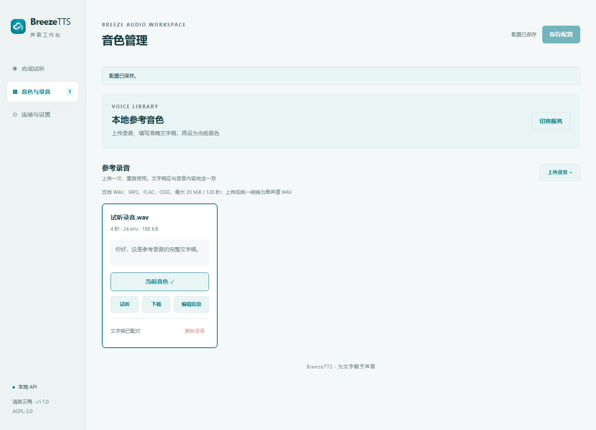

## Official API

Select BreezeBlue official API and enter `https://api.breeze.blue/v1` and your developer key. Save and check the connection, then browse personal or public voices and choose one

For an existing voice, paste the complete `voice_id` in Connection & Settings and save; catalog synchronization is not required. Prefixes and UUIDs are passed through unchanged. Clipboard whitespace, BOM and zero-width padding are removed only at the edges. Do not paste a name, preview ID, URL or extra quotes. For upstream 403/404 errors, check the ID and the API key account’s access. A connection check does not verify permission to synthesize that voice.

Clone creation has its own reference-upload control. Enter a voice name and language, generate a preview, audition it, and save it to your account. Voice design accepts a voice description and preview script

## Controls and playback

Clear buttons sit beside key inputs. Click Clear and save to remove a key; enter a new value and save to replace it. Blank key inputs retain existing saved credentials

Boolean settings use accessible capsule switches. The player sits beside the composer on PC and below it on mobile, showing the audio name, duration, loading state, retry action, and download button. Reopening the workbench loads the most recent generated output

In Connection & Settings → Chat & Runtime, enable random speech and choose its probability, or enable autonomous LLM speech to let the model select passages through `breeze_tts`. Both modes share turn-local duplicate suppression. BreezeTTS delivers replies containing its speech as leading text, standalone voice, and following text. Quotes and mentions stay with substantive text. Delivered content is cleared before downstream splitters run; text-only replies keep the existing AstrBot or splitter settings.

Random speech uses one program-side draw per turn and directly synthesizes a prose passage after a hit, bounded to 200 characters and the configured text limit. Surrounding content retains its order in the plugin's delivery plan. Tool receipts stay internal, and standalone delivery acknowledgments are removed from model replies and the current turn's history.

INFO logs include original synthesis text, actual sections, directions, effective parameters, request/response status, and the resulting audio ID. A `synthesis_id` identifies the operation, and child HTTP `request_id` values share that prefix. Authentication keys, upstream error bodies, and recording bytes are excluded.

Enable **启用动态语调** (Dynamic Tone) under Connection & Settings → Chat & Runtime to use inline native events and section directions. For example, `[style:gentle](laugh)Welcome back. [style:confident]We can do this.` uses independent instructions for each section and joins the resulting WAV audio with natural pauses. Native tags remain in speech input, while recognized controls are hidden from captions and history. Code, escaped literals, ordinary brackets, and Markdown links are preserved. Directions must match the dialogue language, with 1–200 characters each and at most eight markers. The `breeze_tts` tool also accepts an optional overall `instruction`, up to 200 characters. Saved voice descriptions remain in effect. Model support for native events varies; see the [official local model](https://github.com/breezeblue-ai/breeze-tts#-highlights) and [cloud audio tags](https://docs.breezeblue.ai/guides/audio-tags).

Dynamic Tone is off by default. When off, recognized inline controls and per-call instructions are ignored; the configured fixed style still applies. With **概率语音 LLM 语调自适应** (Adaptive Tone for Random Speech) also enabled, the plugin makes one additional LLM call only after a probability hit and passage selection. Choose an existing chat provider in **语调自适应 LLM 提供商**, or leave it empty to follow the current conversation. The LLM selects delivery style without rewriting dialogue. Missing providers, invalid output, and a 20-second timeout fall back to the configured style. No adaptive call runs when Dynamic Tone is off, probability misses, cooldown or quote policy blocks speech, or a tool already handled it.

When keeping the spoken text, the plugin sends its caption first and then a standalone voice message. Text and voice are never combined in a single outgoing message. Use punctuation and single native pause tags rather than stacked pauses or invented duration syntax. Multi-section synthesis returns one WAV file; single-section workbench synthesis retains the configured output format. Chat synthesis uses WAV with at least 400 ms of quiet audio after speech. Existing quiet tails count toward the buffer, and all original samples are preserved.

In Connection & Settings → Chat & Runtime, **输出整数秒语音** (Whole-second voice output) is enabled by default. The hint explains that SnowLuma rounds reported voice durations to the nearest second. When enabled, the plugin pads chat audio up to whole seconds using trailing silence; this works with any adapter. Alignment may add less than one extra second of silence. Disabling it keeps the normal quiet buffer without whole-second alignment. Save the configuration to apply the choice.

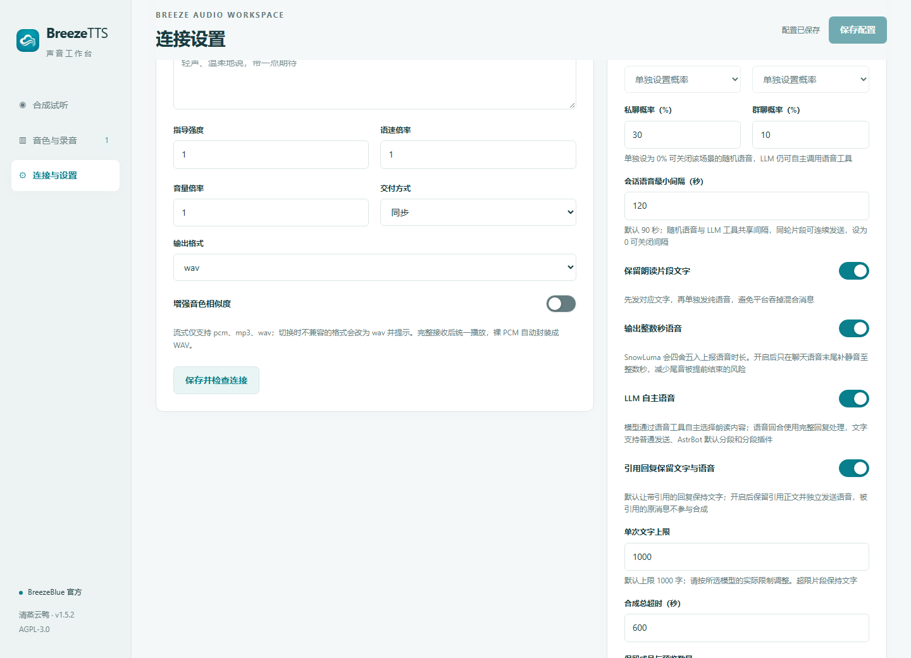

When enabling adaptive tone with prerequisites off, a dialog offers to enable Random Speech and Dynamic Tone together. Confirm and save the workbench settings to apply all three switches. Cancel or Escape restores adaptive tone to off without changing the other switches. The provider picker remains independently configurable. Adaptation runs only when all three switches are enabled.

The former automatic-reply speech option is now Random Speech, and Allow LLM Speech Tool is now Autonomous LLM Speech. Both remain in Chat & Runtime

Private and group conversations can inherit the default probability or use separate values. The conversation interval defaults to 90 seconds and is shared by random speech and LLM tool calls. Different passages in one turn can follow one another; setting the interval to zero disables the cooldown

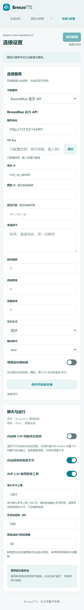

Generated audio and previews have configurable count and capacity limits, defaulting to 50 files and 256 MiB. Reference recordings are retained separately

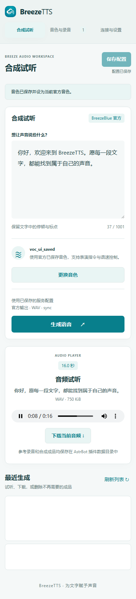

See the [README](../../README.md) for installation, configuration fields, and chat commands

## Expressive AstrBot TTS providers

The existing Local API / BreezeBlue selector remains under Connection & Settings → Current Service. Select **AstrBot TTS Provider** to reuse an enabled MiniMax, ElevenLabs v3/v4, Fish, MiMo, instruction-capable OpenAI TTS, Gemini, Dashscope, Azure, expressive Volcengine voice, or GSVI provider. Models and voices must actually support the selected protocol; credentials and voice configuration remain in AstrBot.

The former **Platform Controls (customizable)** accordion is now an **Edit Platform Controls** dialog. For Breeze, the table is a recommendation reference, not an exhaustive performance allowlist. The LLM may create additional descriptions using `[style:your own delivery description]`, `[语气:自由描述]`, or `instruction`, without registering them first. These become independent performance instructions; known native events remain in speech text. All controls are optional.

A custom Breeze table changes the examples recommended to the LLM while retaining recognition of known native events. Breeze hides the fixed-style field. Closed native catalogs still replace their presets when customized, and fixed emotion values remain strictly validated. Catalogs are saved per platform and shared by its voices. Adjust Azure, Volcengine and GSVI values to the actual voice/model; choose Dashscope protocols according to the actual voice capability.

Apply to Draft, then Save Configuration to persist. Cancel or Escape discards dialog edits. Restore Preset clears dialog overrides, which also requires applying and saving; blank fields use presets.

Fixed platforms require exact API values such as `[style:happy]`; free platforms accept detailed natural-language directions such as `[style:quietly, with restrained excitement]`. Recognized native controls are removed from captions, transcripts and titles, preserving code, escaped literals and Markdown links. Retained text is sent before a separate voice message.

The former Editable Speech Prompts accordion is replaced by **Edit Chat Speech Prompt** and **Edit Random Adaptation Prompt** dialogs under Chat & Runtime. Each dialog shows the complete template; platform rules, tags and output format appear as explicit `{variable}` tokens, with no hidden prompt suffix. Click a variable to insert it at the caret or replace selected text; each button includes an explanation.

| Variable | Runtime content | Scope |
| --- | --- | --- |
| `{platform_name}` | Selected TTS platform / model preset name | Both |
| `{platform_rules}` | Fixed-style or free-instruction rules and capability notes | Both |
| `{audio_tags}` | Effective native tags, including custom replacements | Both |
| `{style_values}` | Exact fixed style values, or a free-instruction description | Both |
| `{control_syntax}` | Section direction, overall instruction, timing and caption rules | Both |
| `{user_message}` | Quoted current user message, limited to 1000 characters | Both |
| `{passage}` | Quoted selected dialogue | Random adaptation |
| `{output_protocol}` | JSON format, optional controls and dialogue-preservation rules | Random adaptation |

**Tags and directions are recommendations, never mandatory.** Plain narration is valid; adaptation may return `{}`, an empty instruction or the unchanged passage. Dynamic Tone must be enabled for controls, and random adaptation also requires Random Speech and LLM Adaptive Tone.

Apply to Draft, then Save Configuration to persist. Cancel or Escape discards dialog edits; restoring defaults also requires applying and saving. Blank templates use defaults. Replacement is single-pass, literal JSON braces need no escaping, and unsupported variables are rejected. Quoted context is not treated as instructions.

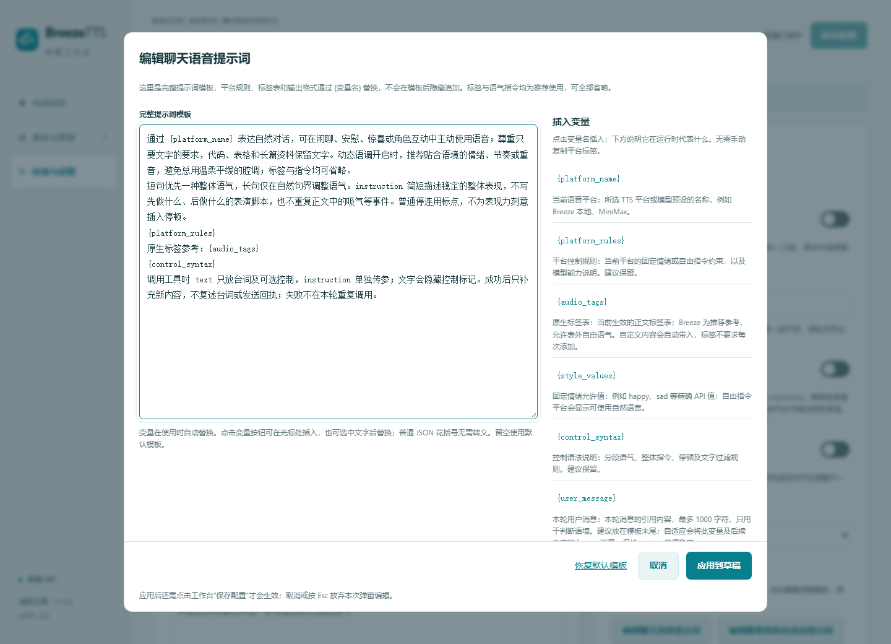

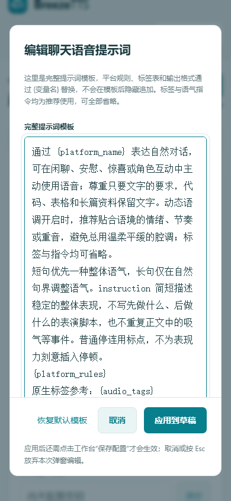

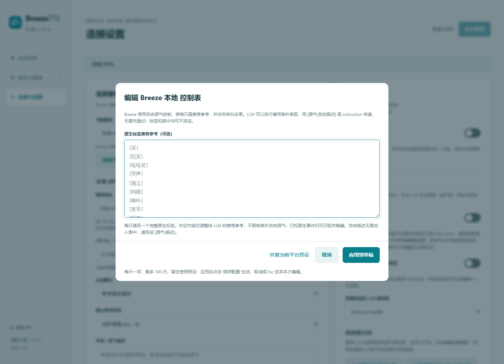

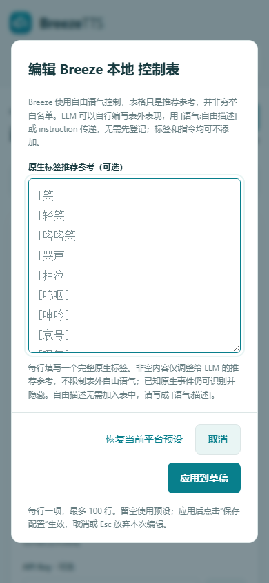

## Protocol and state validation

Navigation is unchanged. HTTP stream delivery offers only bare `pcm`, `mp3` and `wav`. Switching from an incompatible format changes the draft to `wav` with an explicit notice; Save persists it. Sync and async delivery retain all format options.

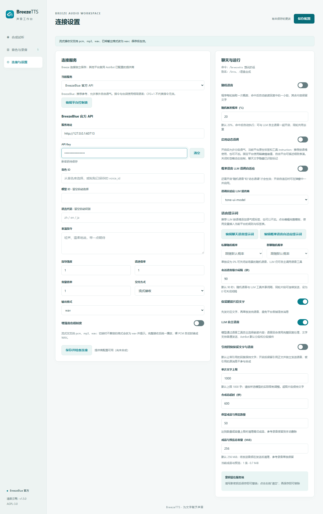

CosyVoice v3-plus custom voices do not support instructions. Custom voices on v3-flash and v3.5-plus/flash accept free instructions; system voices are checked separately against the documented emotion protocol. Manual protocol selection cannot bypass capability checks. The final merged instruction is limited to 100 weighted characters: Han ideographs (including Japanese/Korean Han) count as two, all other characters as one, including newlines and the fixed sentence wrapper. The control and prompt dialogs expose this rule.

A remembered reference is marked Current Voice only while the local service uses reference mode. In plain/design mode, select that same recording to reactivate reference mode. Edits made during any settings save remain in the draft and re-enable Save. Saving an older preview cannot assign its voice ID to a newer preview or change the newer selection.

Random tone adaptation reads JSON. Keep `{output_protocol}` in custom templates or write an equivalent JSON contract. Markdown, dialogue rewrites or inserted whitespace trigger a safe default-tone fallback. Restore the default template to check the success path; custom content is preserved.

Default templates and tool guidance separate spoken `text` from the overall `instruction`. Keep the latter on one line, without tags, within 200 characters. Put section directions before their dialogue, never at the end, empty or stacked consecutively. All controls remain optional. Failure logs include a `stage` such as `llm_request`, `response_json`, `instruction`, `dialogue_preservation` or `section_controls`, without raw model responses or exception details. Updated defaults do not replace saved custom prompts; use Restore Default Template in the editor and save to adopt them.

Prefer one overall tone for short replies. Avoid multi-step scripts, repeated breaths and unnecessary pause tags. Leading native events stay with the following spoken section. Short energy windows recognize quiet noise without removing any original samples, reducing unnecessary whole-second padding.

For LLM prefix caching, fixed templates, platform rules and tags remain in a stable system message; changing context and dialogue follow in a user message. Put custom `{user_message}` and `{passage}` variables last: the first dynamic variable and the remainder of the template move into the user message. Both values are already supplied separately by default. Tool definitions stay stable across probability decisions. Success logs include the provider's `reported_cached_tokens` count, or `None` when unavailable; actual cache hits depend on the LLM service.

The default adaptation template requires strictly one JSON object without Markdown, code fences or explanations. For input dialogue `你好呀。`, a valid example is `{"text":"你好呀。","instruction":""}`. Use the actual input dialogue rather than copying the example; `{}` is also valid for natural narration.

## Breeze-TTS-2.cpp HTTP features

Under **Connection & Settings → Local API → Server implementation**, select **Breeze-TTS-2.cpp (including the authentication/FIFO fork)** and save. Existing configurations keep the Python API choice.

| Server | Example BaseURL | Authentication and scheduling |
| --- | --- | --- |
| [HoppouAI upstream](https://github.com/HoppouAI/Breeze-TTS-2.cpp) | `http://127.0.0.1:8080/v1` | Optional key according to deployment; older builds may omit queue status |
| [WhiteCloudOL fork](https://github.com/WhiteCloudOL/Breeze-TTS-2.cpp) | `http://127.0.0.1:7863/v1` | Bearer key and FIFO waiting |

Root URLs, `/v1`, full speech endpoints and reverse-proxy prefixes remain supported. The plugin checks `/health`, then reads `/v1/model` and optional `/v1/queue`. Only an absent optional endpoint (404) is treated as unavailable; authentication failures, timeouts and malformed data remain errors.

The **Voices & Recordings** navigation entry is unchanged. With C++ selected, **Local Reference Voices** becomes **Local & Server Voices**: the original reference-recording section remains below the new server catalog. Refresh, select a full server ID, or register a plugin reference with its exact transcript. A blank name creates memory-only cache; a name of 1–64 ASCII letters, digits, dashes or underscores saves a `.breeze` file and can overwrite the same name. Unknown IDs fail explicitly rather than falling back to a different voice.

The editor supports descriptions (up to 4096 UTF-8 bytes) and up to 32 string metadata fields (64-character ASCII names using letters, digits, dot, dash or underscore; values up to 1024 bytes). Remove a key or set it to `null` to delete it. Change the selected voice before unloading it. **Unload from memory** keeps saved files, which return after restart; it is not permanent file deletion.

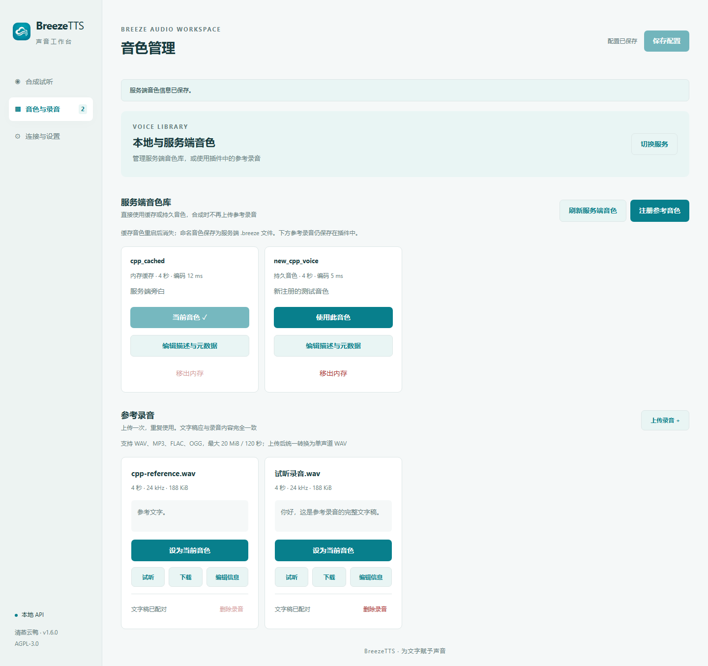
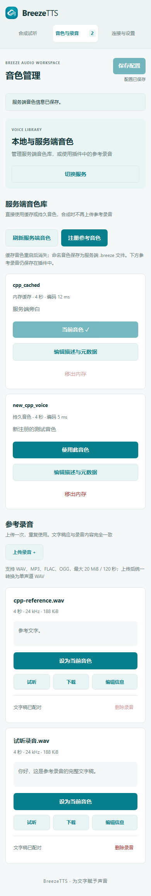
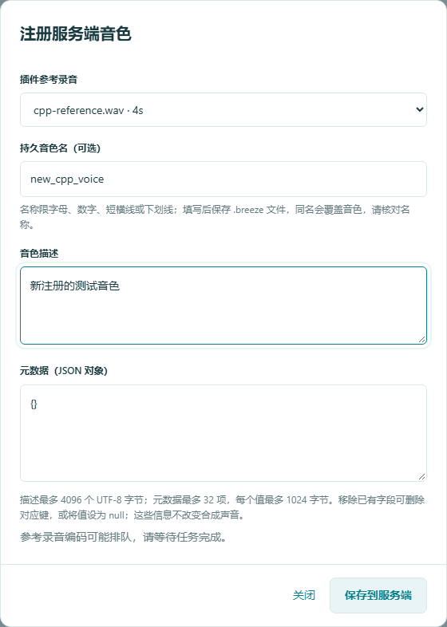
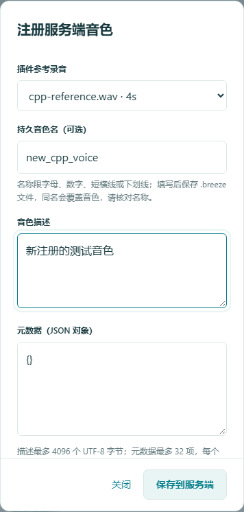

C++ sampling options include Temperature, Top K, Top P and repetition penalty; zero uses model defaults. Split length `-1` uses the server setting, while `0` disables splitting. Maximum frames `0` uses the server default, with approximately 12.5 frames per second. Keep splitting enabled for long text. Single-section workbench output can be PCM, WAV or MP3; WAV/MP3 uses the JSON audio endpoint and registers uploaded references as memory cache when needed. WAV fallback is accepted when MP3 encoding is unavailable, and unknown-length streaming WAV headers are repaired after EOF. Chat delivery and multi-section tone changes always use lossless PCM/WAV without changing saved format preferences.

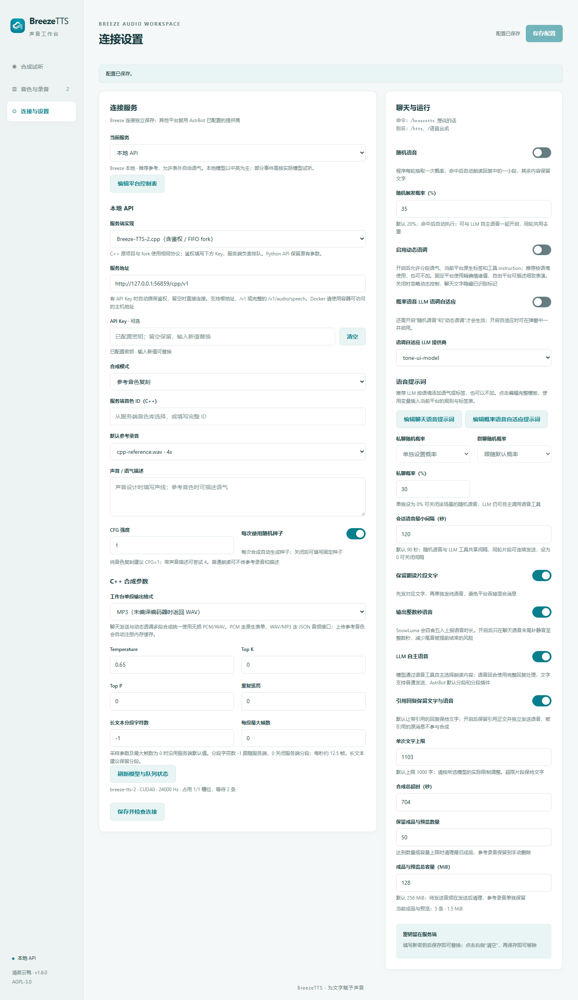

**Voice Conversion (C++)** is added under **Synthesis & Audition**. Upload/select a source recording and choose a server voice or a target reference with its exact transcript. Source transcripts are optional. WAV, MP3, FLAC and OGG uploads retain the existing normalization and size/duration limits. Conversion has independent Temperature, Top K, CFG, seed and acoustic-codebook controls: use zero retained codebooks for speech and optionally try 1–2 for singing. Results appear in Recent Generations for playback/download; conversion does not change the chat voice.

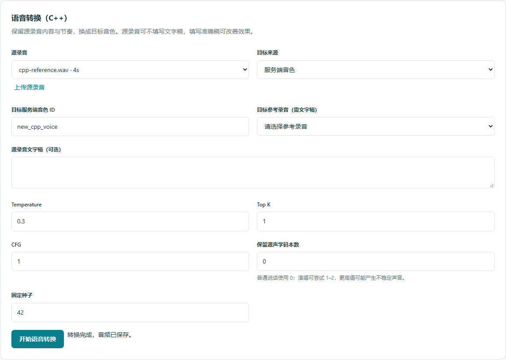
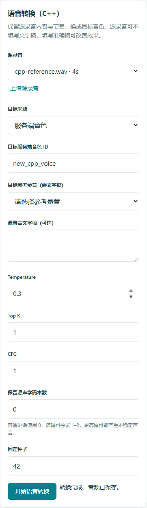

Synthesis, voice registration and conversion use polled jobs with cancellation. Cancellation closes the request; the fork removes disconnected waiters, while stopping an active generation depends on the server. Timeouts include plugin/server queueing and generation. Busy or failed requests are not retried automatically. WebSocket incremental text, live interruption and voice calls are outside this HTTP integration.
