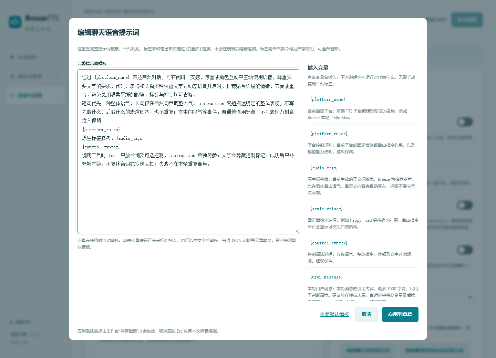
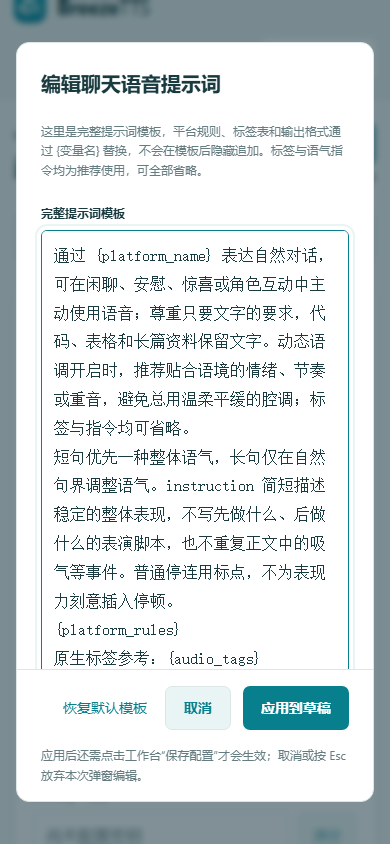
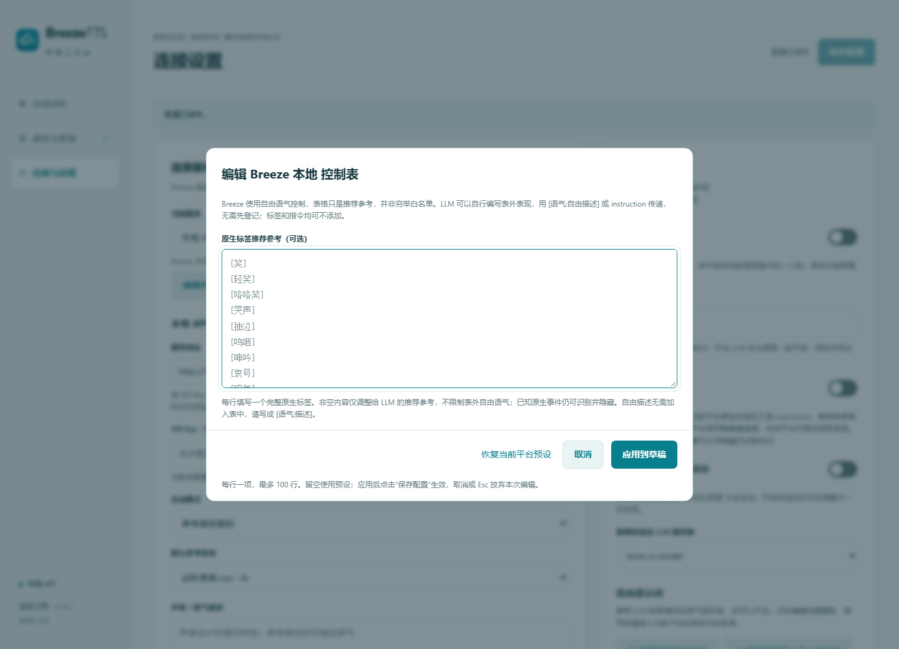
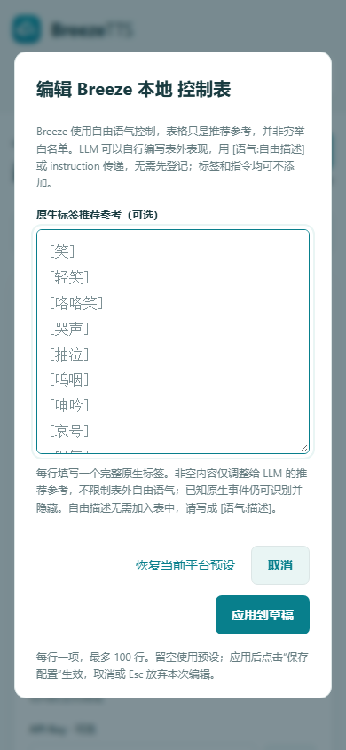
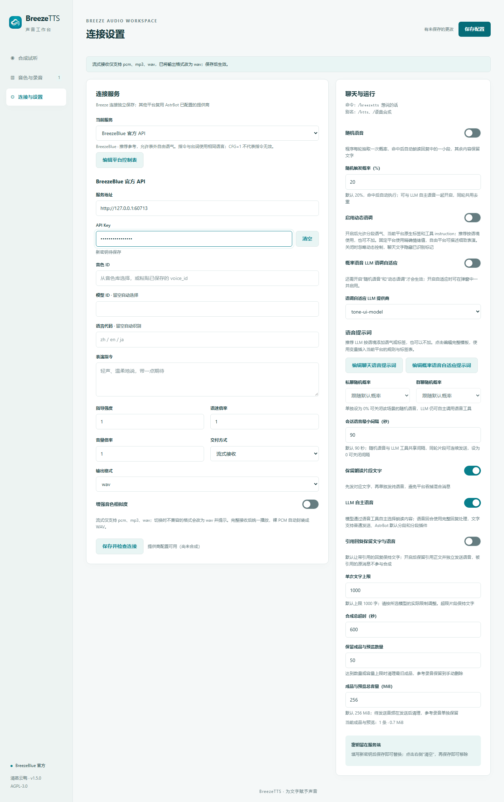

# BreezeTTS 工作台

在“连接与设置 → 聊天与运行”中，先开启 **启用动态语调**，即可使用 `[语气:温柔][轻笑]你好。[语气:坚定]一起走。` 等分段语气和原生音频标签。工具 `breeze_tts` 还支持可选的整体 `instruction`。自由语气转换为独立指令，原生标签保留在合成正文中；聊天文字和语音转写隐藏控制标记。每段语气描述 1–200 字符，一次最多 8 个；分段音频合并成一条 WAV，并补齐自然停顿。原生标签效果以实际模型支持为准。

动态语调默认关闭；关闭时忽略文本中的动态控制和工具传入的 `instruction`，继续使用工作台配置的固定语气。保留朗读片段文字时，先发文字、再独立发纯语音，避免混合消息被平台吞掉。

随机语音还可开启 **概率语音 LLM 语调自适应**，并通过 **语调自适应 LLM 提供商** 选择已配置的聊天模型；留空跟随当前会话。前置开关未启用时，开启自适应会弹窗询问是否一并开启“随机语音”和“动态语调”；确认后点击工作台的“保存”生效，取消或按 Esc 则恢复自适应关闭，其他设置不变。提供商可以独立选择并保存。仅在随机概率命中、选出正文且允许发送语音后额外调用一次 LLM 选择语气，台词保持原样。需要同时开启随机语音和动态语调；提供商不存在、结果无效或超过 20 秒时回退默认语气。更新后重载插件并刷新工作台；现有入口位置保持不变。

在 AstrBot 插件详情中打开 BreezeTTS 工作台，使用顶部或侧边导航进入合成试听、音色管理和连接设置

更新插件后，在插件管理中重载 BreezeTTS，再刷新工作台

| 入口 | 配置与操作 |
| --- | --- |
| 合成试听 | 输入文字、查看当前音色、生成语音、播放和下载成品 |
| 音色与录音 | 根据当前服务展示本地参考音色，或官方账号音色及创建表单 |
| 连接与设置 | 选择服务、设置 API Key、调整声音参数和聊天行为 |

原有“插件配置”入口与工作台共享同一份设置。音色页按当前服务展示对应内容，点击“切换服务”即可进入连接设置

## 本地参考音色

填写本地服务地址，例如 `http://127.0.0.1:7860` 或 `http://127.0.0.1:7861`。API Key 有值时自动发送 Bearer 鉴权，留空时直接连接

在音色页上传参考录音，填写完整准确的文字稿，再点击卡片上的“设为当前音色”。当前音色会有独立标识，卡片中的“试听、下载、编辑信息”成组展示，删除操作位于卡片底部

## 官方账号音色

将服务切换为 BreezeBlue 官方 API，填写 `https://api.breeze.blue/v1` 和 API Key，保存并检查连接。音色页可查询公共或个人音色，点击“使用此音色”完成选择

已有音色时，在连接设置的“音色 ID”中直接粘贴完整 `voice_id` 并保存即可，无需先同步音色目录。不同前缀和 UUID 均按原 ID 传递；首尾空格、换行、BOM 和零宽空格会清理。请勿粘贴名称、预览 ID、网址或额外引号。上游 403/404 时，核对音色 ID 和 API Key 所属账号的访问权限。连接检查成功不代表音色权限已验收。

创建克隆音色时，使用“上传克隆录音”选择录音，再填写名称和语言。声音设计使用文字描述与试听文本。生成预览后先试听，再保存到官方账号

## 密钥与开关

API Key 输入框右侧提供“清空”按钮，点击后保存配置即可移除。输入新密钥后保存可替换，输入留空会保留已保存的密钥

随机语音、保留朗读片段文字、LLM 自主语音和声音相关布尔选项使用胶囊开关，可通过鼠标、触摸或键盘操作

在“连接与设置 → 聊天与运行”中开启随机语音并设置概率，或开启 LLM 自主语音让模型通过工具选择朗读片段。两种模式可以同时使用。文字支持普通发送、AstrBot 默认分段和分段插件；语音只替换选中的片段

随机模式由程序每轮抽取一次概率，命中后直接合成回复中的一小段正文，最多 200 字并遵循单次文字上限，其余内容按原分段方式发送。工具发送结果保留为内部回执，独立的发送状态提示会从模型回复和当轮历史中清理

私聊与群聊可分别选择“跟随默认概率”或“单独设置概率”。会话语音最小间隔默认 90 秒，随机语音与 LLM 工具共享该会话的间隔，同轮片段可连续发送；设为 0 秒可关闭间隔

原“自动语音回复”现为“随机语音”，“允许 LLM 语音工具”现为“LLM 自主语音”，配置入口仍为“聊天与运行”

API 成品与预览可设置保留数量和总容量，默认 50 条 / 256 MiB，参考录音单独保留

## 更多动态语调平台

原有本地 API / BreezeBlue 入口仍位于“连接与设置 → 当前服务”，现在另有 **AstrBot TTS 提供商**。选择 AstrBot 已启用的 MiniMax、ElevenLabs v3/v4、Fish、MiMo、OpenAI 指令型 TTS、Gemini、Dashscope、Azure、多情感火山音色或 GSVI；模型和音色需实际支持相应协议。凭据、音色及连接仍在 AstrBot 提供商设置中管理。

原“平台控制表（可自定义）”折叠区改为“编辑平台控制表”弹窗。Breeze 的标签表是推荐参考，不是穷举白名单；LLM 可自行编写表外语气，用 `[语气:自由描述]` 或 `instruction` 传递，无需先登记，标签与指令也可以不添加。自定义 Breeze 表只调整推荐例子，已知原生事件仍可识别和隐藏，弹窗不显示固定情绪白名单。

固定标签平台的非空表仍替换预设，固定情绪按允许值校验。按平台分别保存，同平台的音色共用。Azure、火山与 GSVI 需要按音色/角色调整允许值；Dashscope 可按实际音色选择指令协议。“应用到草稿”后需点击“保存配置”生效；取消或 Esc 放弃本次编辑，恢复预设也需应用并保存。

固定平台严格使用 `[语气:happy]` 这样的 API 值，自由平台可以使用 `[语气:压低声音，带一点期待]`。标签按当前平台识别并从聊天文字、转写和标题隐藏；代码、转义文字及 Markdown 链接保留。保留正文时，先发文字再发独立语音。

原“语音提示词（可编辑）”折叠区改为“编辑聊天语音提示词”和“编辑概率语音自适应提示词”两个弹窗入口。弹窗包含完整模板，点击变量按钮会在光标处插入 `{变量名}`，也可替换选中文字。每个变量均附说明：`{platform_name}` 为平台名称，`{platform_rules}` 为平台约束，`{audio_tags}` 为生效的标签表，`{style_values}` 为情绪允许值，`{control_syntax}` 为控制语法，`{user_message}` 为本轮消息的引用；概率自适应另有 `{passage}`（待朗读台词）和 `{output_protocol}`（JSON 输出与原文保留规则）。不在模板后隐藏追加提示。

标签与语气都只是按语境推荐，允许完全不加；自适应返回 `{}` 或空 instruction 同样有效。所有动态控制均需启用“动态语调”；概率自适应还需同时启用随机语音与 LLM 自适应，台词不可改写。

“应用到草稿”后点击工作台“保存配置”才会生效；取消或 Esc 放弃本次弹窗编辑。恢复默认模板也需应用并保存。变量只替换一次，普通 JSON 花括号不需转义。

## 播放与手机布局

PC 中播放器位于合成区右侧，手机中位于输入区下方。播放器展示音频名称、时长和当前状态，支持载入重试和下载

完整功能、配置参数和聊天用法见[README](../../README.md)

## 协议与状态校验

入口位置保持不变。连接设置中的“流式接收”仅提供 `pcm`、`mp3`、`wav`；从其他格式切换时会改为 `wav` 并明确提示，保存后生效。同步和后台任务仍提供全部格式。

CosyVoice 的 `v3-plus` 自定义音色不支持指令；`v3-flash`、`v3.5-plus/flash` 自定义音色支持自由指令。系统音色按官方表单独识别固定情感，手动协议不能绕过能力校验。整体与局部指令合并后上限为 100 加权字符：汉字计 2（含简繁、日文及韩文汉字），其他字符计 1，换行与固定句式也计入。控制表和提示词弹窗会显示该规则。

“当前音色”仅表示本地服务正在使用参考模式；普通朗读/声音设计时，记住的录音可再次点击“设为当前音色”激活。保存配置期间继续编辑，新的草稿仍需保存，保存按钮会恢复。旧预览保存完成不会把它的音色 ID 写给后来生成的新预览；可继续独立保存新预览。
